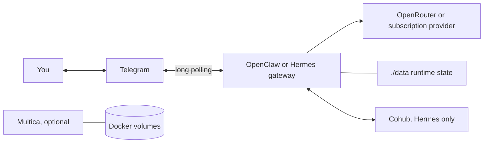

# Lona

Lona is a self-hosted personal AI-assistant deployment kit. It runs either
[OpenClaw](https://openclaw.ai) or [Hermes Agent](https://github.com/NousResearch/hermes-agent)
with Docker Compose, connects them to Telegram, and uses OpenRouter or a
supported subscription provider for models. Hermes deployments also include
Cohub, a local workflow dashboard and control plane.

[](LICENSE)

## Features

- Deploy and operate OpenClaw, Hermes, or the optional Multica agent platform
  through one entry point: `deploy.sh`.
- Run Telegram bots with allowlists and loopback-only dashboards by default.
- Use OpenRouter, including its free-model route, or follow the subscription
  provider guidance in [docs/subscriptions.md](docs/subscriptions.md).
- Run Hermes with Cohub for deterministic workflows, approvals, artifacts, and
  restart-safe execution.
- Seed and reconcile the Hermes enterprise team, or provision a Multica team.
- Back up OpenClaw or Hermes runtime state and use the built-in health and
  update commands for those two runtimes.

## Architecture



OpenClaw and Hermes use the main Compose file; Hermes adds the Cohub overlay.
Multica is an independent Compose deployment with its own database and upload
volumes. Its operational limitations are documented in
[config/multica/DEPLOYMENT.md](config/multica/DEPLOYMENT.md).

## Prerequisites

- Linux host with Docker Compose available to the deploying user.
- Git for a normal clone-based installation. The bootstrap script installs Git
  and Docker when needed.
- For OpenClaw or Hermes: an OpenRouter API key and Telegram bot token. A
  numeric Telegram user allowlist is recommended.
- For Multica: plan secure recovery for its Docker volumes and secrets before
  relying on it for valuable data.

## Quick start

On a fresh host, bootstrap an OpenClaw deployment:

```bash
curl -fsSL https://raw.githubusercontent.com/duthaho/lona/main/scripts/bootstrap.sh | bash -s -- openclaw
```

Use `hermes` as the final argument to bootstrap Hermes instead. On a host that
already has Docker:

```bash
git clone https://github.com/duthaho/lona.git
cd lona
./deploy.sh openclaw
# or: ./deploy.sh hermes
```

The first `up` run creates `.env` from `.env.example`, generates the secrets it
owns, seeds runtime configuration below `data/`, pulls images, and starts the
selected profile. Message the configured Telegram bot after startup.

## Configuration

Keep `.env` private and out of version control. The deployment reads names from
`.env.example`; set only the variables relevant to the selected runtime. Never
put their values in issues, pull requests, or commits.

| Purpose | Environment variable names |
| --- | --- |
| Model access | `OPENROUTER_API_KEY`, `GOOGLE_API_KEY` |
| Telegram | `TELEGRAM_BOT_TOKEN`, `TELEGRAM_ALLOWED_USERS`, `TELEGRAM_GROUP_ALLOWED_CHATS`, `TELEGRAM_GROUP_ALLOWED_USERS` |
| Optional GitHub skills | `GITHUB_TOKEN` |
| OpenClaw | `OPENCLAW_IMAGE`, `OPENCLAW_GATEWAY_TOKEN`, `OPENCLAW_BIND`, `OPENCLAW_PORT` |
| Hermes and Cohub | `HERMES_IMAGE`, `HERMES_UID`, `HERMES_GID`, `HERMES_DASHBOARD_BIND`, `HERMES_DASHBOARD_USER`, `HERMES_DASHBOARD_PASSWORD`, `HERMES_API_SERVER_KEY`, `HERMES_DESIGNER_API_BASE`, `HERMES_DESIGNER_API_KEY`, `COHUB_BIND`, `COHUB_PORT`, `COHUB_API_TOKEN` |
| Shared operational settings | `DOCTOR_CRON_SCHEDULE`, `UPDATE_CRON_SCHEDULE`, `UPDATE_CANARY_WAIT`, `DOCKER_MTU` |
| Multica | `MULTICA_JWT_SECRET`, `MULTICA_POSTGRES_PASSWORD`, `MULTICA_VCS_SECRET_KEY`, `MULTICA_BACKEND_BIND`, `MULTICA_BACKEND_PORT`, `MULTICA_FRONTEND_BIND`, `MULTICA_FRONTEND_PORT`, `MULTICA_ALLOW_SIGNUP`, `MULTICA_API_TOKEN`, `MULTICA_WORKSPACE_ID`, `MULTICA_REVIEWER_EMAIL` |
| Optional Multica integrations | `MULTICA_LLM_BASE_URL`, `MULTICA_LLM_DEFAULT_MODEL`, `GITHUB_APP_SLUG`, `GITHUB_APP_CLIENT_ID`, `GITHUB_APP_CLIENT_SECRET`, `GITHUB_APP_ID`, `GITHUB_APP_PRIVATE_KEY`, `GITHUB_WEBHOOK_SECRET`, `MULTICA_TELEGRAM_SECRET_KEY` |

`deploy.sh` generates the required Multica secrets on its first `up` run.
`MULTICA_API_TOKEN` is used only for authenticated team setup. For the precise
Multica recovery and update constraints, read
[config/multica/DEPLOYMENT.md](config/multica/DEPLOYMENT.md).

## Deployment variants

`deploy.sh` accepts a runtime and an action:

```text
./deploy.sh <openclaw|hermes|multica> [action]
```

| Runtime | Compose configuration | Start command |
| --- | --- | --- |
| OpenClaw | `docker-compose.yml` | `./deploy.sh openclaw up` |
| Hermes with Cohub | `docker-compose.yml` + `docker-compose.hermes.yml` | `./deploy.sh hermes up` |
| Multica | `docker-compose.multica.yml` | `./deploy.sh multica up` |

Common actions are `up`, `down`, `restart`, `logs`, `status`, and `config`.
OpenClaw and Hermes additionally support `sync`, `backup`, `doctor`, `update`,
and `cli`; Hermes also supports `skills`. Multica supports `install-agents` and
`team-setup`, but its `backup`, `doctor`, `cli`, and generic `sync` commands are
intentionally unsupported.

For OpenClaw and Hermes, schedule or remove scheduled health checks with
`doctor install` and `doctor uninstall`. The doctor reads
`DOCTOR_CRON_SCHEDULE`. Manage scheduled transactional updates with `update install`
and `update uninstall`; those runs read `UPDATE_CRON_SCHEDULE` and
`UPDATE_CANARY_WAIT`.

Examples:

```bash
./deploy.sh openclaw status
./deploy.sh hermes skills list
./deploy.sh hermes doctor --deep
./deploy.sh multica install-agents
./deploy.sh multica team-setup --workspace-id <workspace-uuid>
```

For a direct Compose syntax check, use the exact files for each variant:

```bash
docker compose --profile openclaw config -q
docker compose -f docker-compose.yml -f docker-compose.hermes.yml --profile hermes config -q
docker compose -f docker-compose.multica.yml --profile multica config -q
```

## Operations and access

OpenClaw and Hermes persist runtime state under `data/openclaw/` and
`data/hermes/`; Cohub uses `data/cohub/`. Run `./deploy.sh <platform> backup`
to archive OpenClaw or Hermes state. Multica persists PostgreSQL and uploads in
Docker volumes, so it needs an independent, tested recovery plan.

Dashboards bind to loopback by default. Access them through an SSH tunnel or a
properly secured reverse proxy. Cohub is available at its configured loopback
port (default `http://127.0.0.1:8765`) and uses `COHUB_API_TOKEN`; the Hermes
API stays on the private Compose network. See
[docs/multica-team.md](docs/multica-team.md) for the Multica team workflow and
[docs/enterprise-team.md](docs/enterprise-team.md) for the Hermes enterprise-team
configuration.

## Safe updates

OpenClaw and Hermes updates are transactional: `./deploy.sh <platform> update`
backs up runtime state, pulls and recreates the selected runtime, checks it, and
rolls back when the update check fails. The Multica update command is not
transactional; review its constraints in
[config/multica/DEPLOYMENT.md](config/multica/DEPLOYMENT.md) before using it.

## Testing

Run the repository shell test suite from the project root:

```bash
bash tests/run.sh
```

The suite covers deployment wiring, Compose profiles, documentation checks,
Multica deployment behavior, and helper scripts. Run the Compose configuration
commands above when changing Compose files or environment-variable wiring.

## Project layout

```text
deploy.sh                      Deployment and operations entry point
docker-compose.yml             OpenClaw Compose profile
docker-compose.hermes.yml      Hermes and Cohub Compose overlay
docker-compose.multica.yml     Multica Compose deployment
.env.example                   Environment-variable template
config/                        OpenClaw, Hermes, and Multica templates
apps/cohub/                    Cohub service, frontend, and tests
scripts/                       Bootstrap, health, update, skill, and team helpers
tests/                         Repository shell test suite
docs/                          Deployment and provider guidance
data/                          Runtime state (generated and git-ignored)
```

## Documentation

- [Subscription providers](docs/subscriptions.md)
- [Hermes enterprise team](docs/enterprise-team.md)
- [Multica team policy and setup](docs/multica-team.md)
- [Multica deployment and recovery constraints](config/multica/DEPLOYMENT.md)
- [Cohub documentation](apps/cohub/README.md)

## License

[MIT](LICENSE)
